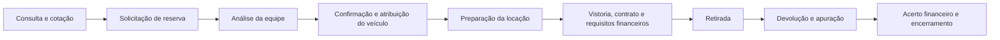

# Apex — Sistema de Gestão de Locação de Veículos

Aplicação web para uma locadora brasileira, reunindo site público, atendimento, frota, reservas, locações, vistorias, contratos, financeiro e manutenção. O sistema atende uma empresa com múltiplas unidades e compartilha a identidade visual Apex entre o site e o painel da equipe.

O cliente consulta os veículos publicados, recebe uma cotação e solicita uma reserva. A equipe analisa o pedido, confirma a disponibilidade e acompanha a operação até a devolução e o fechamento financeiro.

**Situação em 22/10/2026:** módulos principais implementados, banco remoto configurado e primeiro login real de administrador confirmado. A implantação pública e a homologação completa dos fluxos de negócio ainda estão pendentes. A versão local não representa liberação para operação comercial.

[Apresentação para o cliente](docs/apresentacao-cliente.md) · [Estado do Supabase](docs/supabase-project.md) · [Guia de implantação](docs/phase-9.md) · [Critérios de aceite](docs/acceptance.md)

## Conteúdo

- [Funcionalidades](#funcionalidades)
- [Fluxo da operação](#fluxo-da-operação)
- [Perfis de acesso](#perfis-de-acesso)
- [Tecnologias e arquitetura](#tecnologias-e-arquitetura)
- [Executar localmente](#executar-localmente)
- [Variáveis de ambiente](#variáveis-de-ambiente)
- [Configurar o Supabase](#configurar-o-supabase)
- [Prévia visual](#prévia-visual)
- [Testes e verificações](#testes-e-verificações)
- [Publicação e operação](#publicação-e-operação)
- [Limites do escopo](#limites-do-escopo)
- [Documentação](#documentação)

## Funcionalidades

### Site público e atendimento

- Página inicial, catálogo, categorias, detalhes dos veículos, contato e políticas.
- Busca e filtros por marca/modelo, categoria e unidade.
- Publicação controlada de planos, serviços e fotos autorizadas; documentos internos permanecem privados.
- Cotação por período, plano, veículo ou categoria, adicionais e logística de entrega/coleta.
- Solicitação de reserva com dados do cliente e registro da versão das políticas aceitas.
- Protocolo e token privado para consultar a situação do pedido.
- Proteção contra spam com Turnstile, limites de requisições e controles de repetição.

A solicitação pública inicia um pedido para análise. A disponibilidade da cotação é indicativa; a confirmação e a atribuição do veículo ocorrem na aprovação da equipe.

### Cadastros e regras comerciais

| Módulo              | Recursos principais                                                                                                                            |
| ------------------- | ---------------------------------------------------------------------------------------------------------------------------------------------- |
| Frota               | Veículos, categoria/unidade, placa, características, quilometragem, situação, fotos, documentos e histórico autorizado de locações/manutenção. |
| Categorias          | Organização dos grupos de veículos e dados usados nas ofertas e tarifas.                                                                       |
| Unidades            | Organização dos locais de atendimento e vínculos da frota.                                                                                     |
| Clientes            | Pessoas físicas e jurídicas, documentos, contatos e endereço brasileiro.                                                                       |
| Condutores          | Vínculo com o cliente, CNH, categoria, validade e documentos.                                                                                  |
| Planos              | Regras de diária, semana e mês, excedentes, tolerâncias, caução, descontos, logística e prazos.                                                |
| Preços              | Valores por categoria ou veículo, com vigência e proteção contra sobreposições incompatíveis.                                                  |
| Serviços adicionais | Itens extras, regras de cobrança e publicação no site.                                                                                         |

Os cadastros oferecem consulta, criação, edição e arquivamento/restauração conforme as permissões e os vínculos existentes. Alterações concorrentes são verificadas para evitar sobrescrever outra edição.

Há validações de CPF/CNPJ, telefone, CEP/UF, datas, placas brasileiras e formato de documentos veiculares e CNH. Elas não substituem conferência de identidade, autenticidade ou consulta a órgãos oficiais.

### Reservas e disponibilidade

- Cotações detalhadas com itens, descontos autorizados, taxas, total, caução separada e validade.
- Solicitação, análise, aprovação, rejeição, cancelamento e expiração de pedidos pendentes.
- Atribuição de veículo na confirmação e histórico das decisões.
- Proteção transacional contra conflitos entre reservas confirmadas, locações, bloqueios e manutenções.
- Intervalo de preparação entre compromissos conforme a regra comercial.
- Tratamento de repetição de operações para evitar duplicidade.

### Locações, retirada e devolução

- Criação de locação direta ou conversão única de reserva confirmada.
- Preparação com cliente, condutores, veículo, valores e regras preservados no histórico.
- Registro da logística de retirada/devolução e de sua execução.
- Retirada condicionada aos requisitos configurados de documentação, CNH, vistoria, contrato, recebimento e caução.
- Prorrogação com nova verificação de disponibilidade e registro de aditivo.
- Controle de locações em preparação, em andamento, atrasadas, concluídas e canceladas.
- Devolução com quilometragem, combustível, avarias e cálculo dos excedentes configurados.
- Encerramento e liberação da ocupação após atender às condições operacionais e financeiras.

### Vistorias, documentos e contratos

- Checklists versionados, vistorias inicial e final, observações, avarias e fotos.
- Anexos privados, com validação de conteúdo/tamanho e acesso autorizado.
- Modelos de contrato versionados, condicionados à revisão e aprovação da locadora.
- Geração de contratos e aditivos em PDF, com identificação das partes, veículo, valores, condições e campos de assinatura.
- Processamento de PDFs em fila, controle de versões e tentativas de recuperação de falhas.

O PDF gerado não equivale a assinatura eletrônica. A avaliação de avarias e a aprovação do texto contratual continuam sob responsabilidade da operação.

### Financeiro

- Cobranças com competência e vencimento; pagamentos confirmados, parciais e alocados em cobranças.
- Créditos do cliente, descontos autorizados e ajustes com justificativa.
- Cauções recebidas, aplicadas e devolvidas, separadas da receita.
- Registro de reembolsos, despesas e compensações, preservando os lançamentos originais.
- Despesas vinculáveis a veículos e manutenções.
- Meios de pagamento e limites de desconto configuráveis por administrador.

O módulo registra a movimentação informada e confirmada por um funcionário autorizado. Não executa transferências, Pix, cobranças em cartão ou estornos bancários.

### Manutenção, indicadores e relatórios

- Agenda de manutenção preventiva, corretiva, óleo, pneus e revisão.
- Agendamento, início, reagendamento, extensão, conclusão e cancelamento com histórico.
- Bloqueio de disponibilidade quando aplicável, próxima data/quilometragem e alertas de vencimento.
- Registro opcional de despesa na conclusão, sujeito às permissões financeiras.
- Dashboard com indicadores operacionais e financeiros conforme o cargo.
- Dez tipos de relatório: faturamento por competência, recebimentos, despesas, resultado por veículo, saldos, reservas, ocupação, clientes recorrentes, locações vencidas e manutenção.
- Exportação CSV da página selecionada, com até 100 linhas por exportação.

O resultado por veículo compara valores contratados e despesas vinculadas; não inclui toda a contabilidade da empresa. A ocupação usa o histórico observado da frota e sinaliza períodos com cobertura limitada.

### Equipe, configurações e notificações

- Gestão de acessos, ativação/revogação e atribuição de cargos, com proteção do último ADMIN ativo.
- Configuração da empresa, regras operacionais, publicação do site e textos comerciais.
- Caixa de notificações própria para cada funcionário autorizado.
- Regras, templates versionados, filas e tratamento de falhas de processamento.
- Adaptador de e-mail de negócio preparado para Resend, condicionado a provedor, domínio, rotas e tarefas agendadas.

## Fluxo da operação



Também é possível iniciar uma locação diretamente no atendimento. Preços e disponibilidade finais são validados no servidor e no banco, e as operações preservam histórico e regras aceitas.

## Perfis de acesso

| Perfil      | Responsabilidade                                                                                                                            |
| ----------- | ------------------------------------------------------------------------------------------------------------------------------------------- |
| `ADMIN`     | Administração completa, configurações, equipe e concessões de acesso.                                                                       |
| `MANAGER`   | Gestão operacional e financeira, com aprovações e descontos dentro das regras; sem gestão de usuários ou configurações exclusivas do ADMIN. |
| `ATTENDANT` | Atendimento, clientes/condutores, solicitações de reserva e execução operacional autorizada; sem confirmação de pagamentos.                 |
| `FINANCE`   | Cobranças, recebimentos, cauções, despesas e relatórios financeiros; recebe somente os dados operacionais mínimos necessários.              |

A autorização é verificada no servidor e nas políticas do banco. Documentos pessoais e dados financeiros têm permissões próprias. Consulte a [matriz de permissões](docs/security/permissions.md).

## Tecnologias e arquitetura

| Camada                  | Implementação                                                                           |
| ----------------------- | --------------------------------------------------------------------------------------- |
| Runtime                 | Node.js 24.x e npm                                                                      |
| Aplicação               | Next.js 16.4.2, App Router, React 19.3.1 e TypeScript strict                            |
| Interface               | Tailwind CSS 4, componentes locais, Lucide e fonte Manrope                              |
| Formulários e validação | React Hook Form, Zod e validação repetida no servidor                                   |
| Dados e identidade      | PostgreSQL, Supabase Auth, sessões SSR e Storage privado                                |
| Valores e datas         | Centavos inteiros/BigInt no motor, `numeric` no banco e Temporal para datas/fusos       |
| PDFs                    | pdf-lib, fontkit e Noto Sans local                                                      |
| Testes                  | Vitest, Playwright, Axe, PostgreSQL isolado e suíte pgTAP preparada para Supabase local |

O projeto é um monólito modular para **uma empresa**, com múltiplas unidades possíveis. Não oferece isolamento entre empresas de um SaaS multiempresa.

```text
src/
  app/                 Site, autenticação, painel e APIs
  components/          Componentes e formulários da interface
  config/              Ambiente, navegação e requisitos de deploy
  lib/                 Serviços, regras e acesso aos dados por domínio
  types/               Tipos compartilhados e gerados do banco
supabase/
  migrations/          Evolução versionada do banco
  seeds/               Dados exclusivos de desenvolvimento
  templates/           Template de recuperação de senha
  tests/               Testes SQL/pgTAP
tests/                 Unitários, navegador, interface e Supabase local
scripts/               Qualidade, testes, prévia e empacotamento
docs/                  APIs, arquitetura, regras e procedimentos operacionais
public/                Arquivos públicos e identidade visual
assets/fonts/          Fontes locais e respectivas licenças
.github/workflows/     Pipelines de qualidade e banco
```

### Proteções implementadas

- Sessões SSR, validação de identidade e autorização por funcionário ativo/cargo.
- RLS nas tabelas da aplicação e permissões restritas de funções e arquivos.
- Constraints, locks, controle de versão e idempotência nas operações críticas.
- Histórico financeiro preservado por lançamentos compensatórios.
- Documentos privados e links temporários emitidos após autorização.
- Validação de origem, limites de requisição e respostas sensíveis sem cache.
- Token privado para consulta de reserva, com hash persistido e resposta pública mínima.
- Auditoria das operações previstas e isolamento das credenciais de servidor.

Essas proteções têm testes locais e verificações remotas parciais. A homologação com usuários de todos os cargos e dados controlados continua necessária.

## Executar localmente

### Pré-requisitos

- Node.js **24.x**, conforme `engines` do projeto, npm e Git.
- Projeto Supabase configurado para testar os fluxos reais, ou stack local descartável.
- Docker e Supabase CLI somente para a stack Supabase local completa e seus testes específicos.

```sh
git clone https://github.com/IraquianRodrigues/locadora-pro.git
cd locadora-pro
npm ci
```

Na primeira configuração, crie o arquivo local de ambiente. Não sobrescreva um `.env.local` já configurado.

PowerShell:

```powershell
if (!(Test-Path .env.local)) { Copy-Item .env.example .env.local }
```

Bash:

```sh
test -f .env.local || cp .env.example .env.local
```

Preencha as variáveis necessárias e inicie:

```sh
npm run dev
```

- Site: `http://localhost:3000/`
- Login da equipe: `http://localhost:3000/login`
- Painel: `http://localhost:3000/admin/dashboard`

Use a mesma origem em `NEXT_PUBLIC_APP_URL`, no navegador e nos callbacks do Auth, inclusive hostname e porta. Sem configuração válida, as operações dependentes permanecem indisponíveis; não há credenciais padrão nem administrador criado automaticamente ao clonar.

## Variáveis de ambiente

O arquivo [.env.example](.env.example) contém todos os nomes e comentários. Valores reais ficam no `.env.local` ignorado pelo Git ou no gerenciador de segredos da hospedagem.

| Variável                               | Finalidade                                                                          |
| -------------------------------------- | ----------------------------------------------------------------------------------- |
| `NEXT_PUBLIC_APP_URL`                  | Origem canônica; HTTPS real para produção.                                          |
| `APP_TIMEZONE`                         | Fuso IANA, inicialmente `America/Fortaleza`; alinhar com a configuração da empresa. |
| `NEXT_PUBLIC_SUPABASE_URL`             | Origem do projeto Supabase, sem o sufixo `/rest/v1/`.                               |
| `NEXT_PUBLIC_SUPABASE_PUBLISHABLE_KEY` | Chave publicável; chave legada `anon` compatível também é aceita.                   |
| `SUPABASE_SERVICE_ROLE_KEY`            | Chave privilegiada, exclusivamente do servidor, para tarefas delimitadas.           |
| `AUTH_SECRET`                          | Segredo de assinatura/HMAC de recuperação, limites e tokens de consulta.            |
| `NEXT_PUBLIC_TURNSTILE_SITE_KEY`       | Chave pública do widget antispam.                                                   |
| `TURNSTILE_SECRET_KEY`                 | Validação do antispam no servidor.                                                  |
| `RENTAL_JOBS_SECRET`                   | Autorização do worker de contratos e atrasos.                                       |
| `OPERATIONS_JOBS_SECRET`               | Autorização do worker de operação, financeiro e notificações.                       |
| `READINESS_SECRET`                     | Autorização do monitor privado de prontidão.                                        |
| `NOTIFICATION_EMAIL_PROVIDER`          | Provedor opcional de e-mails de negócio: `resend`.                                  |
| `RESEND_API_KEY`                       | Credencial privada do provedor de e-mail.                                           |
| `NOTIFICATION_FROM`                    | Endereço remetente verificado.                                                      |

`AUTH_SECRET` e os três segredos internos precisam ter pelo menos 32 caracteres e ser distintos. Gere cada um separadamente em um ambiente privado:

```sh
node -e "console.log(require('node:crypto').randomBytes(32).toString('base64url'))"
```

As variáveis `NEXT_PUBLIC_*` entram no bundle do navegador. Nunca use esse prefixo em chave de serviço, segredo de assinatura ou credencial de e-mail. Reconstrua a aplicação ao alterar valores públicos usados no build. Configurar o Resend de negócio não configura o SMTP do Supabase Auth.

## Configurar o Supabase

O repositório contém **26 migrations**. O projeto remoto autorizado possui **64 tabelas com RLS** e quatro buckets privados: `vehicle-images`, `documents`, `inspections` e `contracts`.

Para um ambiente novo:

1. Separar desenvolvimento, homologação e produção; selecionar explicitamente o projeto correto.
2. Revisar e aplicar as migrations na ordem pelo mecanismo do Supabase. O seed de desenvolvimento não contém dados comerciais aprovados e não deve ir para produção.
3. Configurar Auth: cadastro público e sign-ins anônimos desligados, provedores necessários, política de senha e callbacks exatos da origem.
4. Criar o primeiro usuário por canal administrativo, com senha definida privadamente e e-mail confirmado. Ativar o perfil e atribuir ADMIN conforme o [procedimento de bootstrap](docs/database/setup.md#bootstrap-do-primeiro-admin).
5. Conferir buckets privados, RLS, grants, tipos gerados e acesso HTTP com os cargos previstos.
6. Cadastrar empresa/unidades, frota, tarifas, meios de pagamento, regras e modelos contratuais aprovados.
7. Configurar Turnstile antes de habilitar solicitações públicas e publicar somente o conteúdo comercial aprovado.

No projeto remoto já configurado, **não reaplique migrations registradas e não execute reset**. O manifesto do histórico está em [remote-migrations.json](docs/database/remote-migrations.json).

Auth básico, chave de servidor e primeiro ADMIN já foram configurados no ambiente atual, com primeiro login real confirmado. Recuperação de senha permanece adiada: o template personalizado e a entrega dependem da configuração de e-mail aprovada. O estado atualizado está em [supabase-project.md](docs/supabase-project.md); documentos por fase também preservam registros históricos.

## Prévia visual

Para revisar componentes e estados sem usar a sessão ou o banco:

```sh
npm run preview:frontend
```

Abra `http://127.0.0.1:3230`. A prévia usa **dados sintéticos identificados**; permite navegar e experimentar controles, mas recusa gravação, publicação, uploads e movimentações. Não valida uma operação real nem faz parte do deploy.

As telas abrangem cadastros, reservas, locações, financeiro, manutenção, relatórios, notificações, equipe e configuração do site. Veja os estados e endereços em [frontend-apex.md](docs/frontend-apex.md).

## Testes e verificações

| Comando                      | Objetivo                                                           |
| ---------------------------- | ------------------------------------------------------------------ |
| `npm run lint`               | ESLint sem warnings.                                               |
| `npm run typecheck`          | Geração dos tipos de rotas e verificação TypeScript.               |
| `npm run format:check`       | Conferência de formatação.                                         |
| `npm run check:security`     | Regras estáticas de segurança e fronteiras de importação.          |
| `npm run check:api`          | Validação dos contratos OpenAPI e cobertura das rotas.             |
| `npm test`                   | Testes unitários.                                                  |
| `npm run test:db`            | PostgreSQL isolado e descartável, migrations e cenários SQL.       |
| `npm run build`              | Build de produção, incluindo checagem de tipos.                    |
| `npm run test:standalone`    | Smoke do pacote standalone, assets e PDF.                          |
| `npm run test:e2e`           | Testes de navegador sobre o build, na porta 3100.                  |
| `npm run test:ui`            | Prévia de interface em desktop/celular, Axe e largura da página.   |
| `npm run test:db:supabase`   | pgTAP na stack Supabase local.                                     |
| `npm run test:supabase:http` | Auth/SSR/PostgREST/Storage em stack local descartável configurada. |
| `npm run deploy:check`       | Requisitos sintáticos de configuração para produção.               |

Para as suítes de navegador, instale o Chromium:

```sh
npx playwright install chromium
```

Execute `npm run build` antes de `test:e2e`, `test:standalone` e da suíte HTTP que utiliza o pacote de produção. A suíte HTTP Supabase exige variáveis e contas locais próprias; siga [phase-9.md](docs/phase-9.md#supabase-local-completo-e-http-real). Nunca a aponte para o projeto remoto ou uma base com dados operacionais.

O teste PostgreSQL isolado não usa `DATABASE_URL` e não reproduz todos os serviços do Supabase. A suíte de interface usa a prévia; a suíte E2E padrão cobre fronteiras e cenários específicos, não substituindo o percurso autenticado completo.

Os últimos registros de desenvolvimento incluem **175 testes unitários, 46 E2E, 76 de interface e 81 cenários de banco isolado**, em execuções e escopos distintos. A retomada de Auth também registrou 40 testes locais e nove verificações anônimas remotas aprovadas. Esses números são evidências históricas, não uma nova execução conjunta. Datas e limites constam em [verification.md](docs/verification.md), [frontend-apex.md](docs/frontend-apex.md) e [supabase-project.md](docs/supabase-project.md).

## Publicação e operação

Há empacotamento Next.js standalone, script de inicialização e Dockerfile com runtime sem root. A imagem Docker e a implantação no provedor escolhido ainda precisam ser validadas.

Após configurar o ambiente correspondente:

```sh
npm run deploy:check
npm run build
npm run start -- --hostname 127.0.0.1 --port 3000
```

O gate verifica configuração; passar nele não comprova entrega de e-mail, restauração de backup ou aceite operacional.

### Endpoints operacionais

| Endpoint                           | Uso                                                                     |
| ---------------------------------- | ----------------------------------------------------------------------- |
| `GET /api/v1/health`               | Liveness da aplicação; não comprova integração com o banco.             |
| `GET /api/internal/readiness`      | Prontidão privada de configuração, Auth, banco, schema, RLS e buckets.  |
| `POST /api/internal/rental-jobs`   | Processamento de contratos e atividades de locação previstas no worker. |
| `POST /api/internal/business-jobs` | Processamento operacional, financeiro, manutenção e notificações.       |

Os três endpoints internos exigem `Authorization: Bearer <segredo correspondente>`. Configure agendadores e monitoramento no ambiente de hospedagem; não coloque segredos em URLs. A expiração periódica das reservas pendentes também precisa de agendamento conforme [reservations.md](docs/reservations.md).

### Pendências para operação comercial

- Domínio e hospedagem HTTPS, configuração por ambiente e revisão de segredos.
- Turnstile com chaves e hosts reais; publicação explícita do catálogo.
- Dados comerciais, valores, políticas, checklists e contratos aprovados pela Apex.
- Homologação de login/refresh/logout, quatro cargos, Storage e ciclo completo da locação.
- Tarefas agendadas e verificação do processamento dos contratos e notificações.
- Configuração de e-mails quando aprovada; recuperação por e-mail não está operacional no ambiente atual.
- Backup de banco **e objetos do Storage**, restauração ensaiada, retenção e responsáveis por incidentes.
- Revisão final, aceite da empresa e deploy com plano de recuperação.

Na última verificação local, o gate de deploy ainda apontava origem HTTPS e as duas chaves Turnstile ausentes. Não houve deploy público. O procedimento de implantação e recuperação está em [phase-9.md](docs/phase-9.md).

## Limites do escopo

- Pagamentos e reembolsos são registros administrativos; não há gateway, Pix automático, integração bancária ou conciliação de adquirente.
- Não há assinatura eletrônica de contratos, emissão fiscal, rastreamento GPS ou integração com DETRAN/Receita.
- Não há envio automático por WhatsApp nem aplicação móvel nativa; a interface web é responsiva.
- CSV exporta a página selecionada; relatórios em PDF e exportação integral não fazem parte da entrega atual.
- E-mails dependem de serviços/configuração. Aceite pelo provedor não comprova entrega ao destinatário.
- Não há garantia automática de autenticidade documental, disponibilidade baseada apenas na situação do veículo ou conformidade jurídica dos textos.
- A arquitetura atual não é multiempresa. Observabilidade externa, metas de recuperação e políticas de retenção precisam de definição operacional.

## Documentação

| Tema                      | Referências                                                                                                                                                                             |
| ------------------------- | --------------------------------------------------------------------------------------------------------------------------------------------------------------------------------------- |
| Apresentação e identidade | [Resumo para o cliente](docs/apresentacao-cliente.md), [produto](PRODUCT.md), [design](DESIGN.md), [frontend](docs/frontend-apex.md)                                                    |
| Arquitetura               | [Visão geral](docs/architecture/overview.md), [decisões](docs/architecture/decisions.md), [ambiente](docs/architecture/environment.md)                                                  |
| Banco e Supabase          | [Estado remoto atual](docs/supabase-project.md), [setup](docs/database/setup.md), [schema](docs/database/schema.md), [ER](docs/database/erd.md), [políticas](docs/database/policies.md) |
| Acesso e segurança        | [Auth](docs/authentication.md), [permissões](docs/security/permissions.md), [segurança](docs/security.md)                                                                               |
| Cadastros e comercial     | [Cadastros/Storage](docs/registry.md), [tarifas](docs/business-rules/pricing.md), [reservas](docs/reservations.md), [site público](docs/public-site.md)                                 |
| Operação                  | [Locações, vistorias e PDF](docs/rentals.md), [financeiro, manutenção e notificações](docs/business-operations.md)                                                                      |
| APIs                      | [API v1 OpenAPI](docs/api/openapi.yaml), [API interna](docs/api/internal.openapi.yaml), [operações de negócio](docs/api/business.md)                                                    |
| Qualidade e implantação   | [Verificações](docs/verification.md), [Fase 9](docs/phase-9.md), [aceite](docs/acceptance.md), [backlog](docs/backlog.md)                                                               |

## Licenças e arquivos do repositório

As licenças das fontes estão em [Manrope-OFL.txt](assets/fonts/Manrope-OFL.txt) e [OFL.txt](assets/fonts/OFL.txt). A procedência do material decorativo de marca acompanha o arquivo em `public/brand/`. Não há um arquivo de licença geral do código neste repositório.

Segredos, dependências, builds, capturas e saídas locais ficam fora do Git. A configuração real de qualquer ambiente deve ser fornecida separadamente; clonar o projeto não copia credenciais nem dados da locadora.
