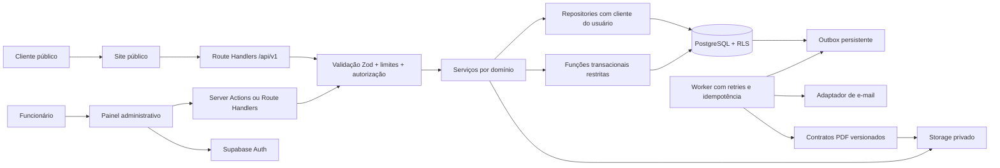

# Arquitetura técnica

## Escopo e limites

Uma empresa, múltiplas unidades possíveis, sem `tenant_id`. Monólito modular em Next.js App Router, React e TypeScript strict. Site público e painel compartilham design system e serviços; regras nunca dependem do navegador. PostgreSQL é a autoridade para ocupação, pagamentos, estados e valores aprovados.



## Responsabilidades

| Camada     | Responsabilidade                                              | Proibição                                           |
| ---------- | ------------------------------------------------------------- | --------------------------------------------------- |
| UI         | Interação, acessibilidade, estados de carregamento            | Decidir autorização, preço ou disponibilidade final |
| Entrada    | Zod, autenticação, RBAC, Origin/CSRF, limites                 | Repetir regra transacional                          |
| Serviço    | Casos de uso e transições permitidas                          | Depender de componentes React                       |
| Repository | Consultas parametrizadas e RPCs                               | Usar service role como cliente padrão               |
| SQL/RPC    | Locks, constraints, consistência, auditoria e outbox atômicas | Confiar em cargo ou preço recebido do cliente       |
| Worker     | E-mail/PDF, retries limitados, dead letters                   | Confirmar reserva fora da transação                 |

APIs retornam envelopes estáveis e IDs de correlação; erros internos não são publicados. Server Components são o padrão. React Hook Form e Zod entram no primeiro formulário real. TanStack Query somente onde cache e mutações no cliente forem úteis; Zustand somente se surgir estado compartilhado não coberto por URL/React. PDF, Sentry e e-mail serão escolhidos na fase correspondente, sem instalar adaptadores sem uso.

## Estrutura final planejada

Diretórios futuros serão criados quando contiverem implementação. A árvore é um plano, não afirma que todas as rotas já existem.

```text
src/
  app/
    (public)/
      layout.tsx, page.tsx
      veiculos/[id]/, categorias/, reservar/, contato/, politicas/
    (auth)/login/, recuperar-senha/
    (dashboard)/admin/
      layout.tsx, dashboard/, veiculos/, categorias/, clientes/
      reservas/, locacoes/, contratos/, vistorias/, financeiro/
      manutencoes/, relatorios/, usuarios/, configuracoes/
    api/v1/public/, admin/, webhooks/, health/
  components/
    ui/, layout/, forms/, tables/, feedback/, shared/
  modules/
    auth/, vehicles/, categories/, customers/, drivers/
    availability/, pricing/, reservations/, rentals/, contracts/
    inspections/, payments/, finance/, maintenance/, reports/
    notifications/, audit/, settings/
  lib/
    supabase/client.ts, server.ts, admin.ts
    auth/, validation/, errors/, security/, utils/
  hooks/, types/, config/
supabase/
  migrations/, seeds/, tests/
tests/
  unit/, integration/, e2e/
docs/
  architecture/, api/, database/, business-rules/, decisions/, security/
public/
.github/workflows/
```

Módulos conterão schemas, services, repositories, actions, types, components e tests apenas quando necessários. Importações entre domínios passam por serviços/tipos públicos, sem acesso direto às tabelas de outro domínio na UI.

## Dados e consistência

- `timestamptz` para instantes; `date` para nascimento, aquisição e validade documental. A API aceita instantes ISO 8601 com offset. Conversão de horário local considera o timezone configurado da empresa.
- Valores SQL `numeric(12,2)`; fronteiras JSON usam strings decimais. Motor usa aritmética decimal ou centavos inteiros com limites, nunca soma financeira de ponto flutuante.
- Intervalos `[início,fim)`: devolução e retirada no mesmo instante são permitidas somente se a regra de preparação não acrescentar um bloqueio.
- Uma tabela de alocações efetivas protege reserva, locação, manutenção e bloqueios. Estado operacional do veículo é independente de ocupação.
- Snapshot comercial imutável acompanha orçamento aprovado, locação e contrato. Alterações em tarifa não reescrevem o histórico.
- Chaves de idempotência por operação; criação e resultado gravados na mesma transação. Outbox grava eventos junto à alteração principal.
- Paginação limitada, índices compostos por consultas, ordenação com desempate por ID. Storage guarda objetos; SQL guarda metadados e vínculo de autorização.

## Primeira implementação (Fase 1)

1. Criar package/lockfile e scripts em Node 24, TypeScript strict, Next App Router.
2. Configurar Tailwind, componentes shadcn locais, tokens, layout público e limites de navegação.
3. Oferecer páginas de preparação honestas e painel fechado; nenhuma métrica fictícia.
4. Criar clientes Supabase browser/server/admin com validação de ambiente e isolamento de segredo.
5. Adicionar lint, formatação, testes de configuração, E2E da fundação e CI.
6. Validar types, lint, testes, build, acessos sem credenciais e auditoria; registrar evidências.

Condição de conclusão da fase: base reproduzível sem credenciais, sem exposições administrativas, sem dependência de dados mockados. Não inclui login, CRUD, banco aplicado nem deploy público.
