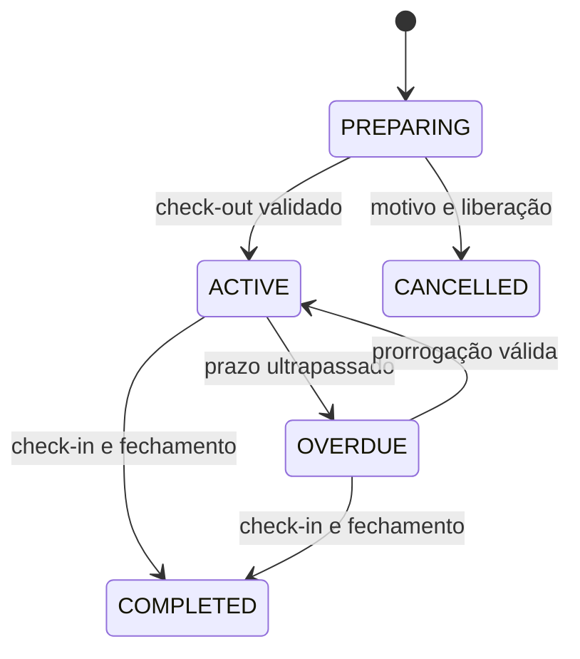

# Locações, vistorias e financeiro

Fluxo operacional da Fase 7 implementado; configuração e limites em [rentals.md](../rentals.md). A interface financeira completa e manutenção permanecem na Fase 8.

```mermaid
flowchart LR
  A[Reserva confirmada ou atendimento direto] --> B[Transação cria locação e mantém/cria alocação]
  B --> C[Condutores válidos + contrato + vistoria inicial]
  C --> D[Recebimento confirmado por usuário autorizado]
  D --> E[Check-out: ACTIVE e km/combustível iniciais]
  E --> F{Prorrogação?}
  F -->|Sim| G[Transação revalida conflito e registra aditivo]
  G --> H[Uso do veículo]
  F -->|Não| H
  H --> I[Vistoria final + km/combustível + cobranças extras]
  I --> J[Fechamento configurado + check-in]
  J --> K[COMPLETED + liberação + auditoria + outbox]
```

## Regras operacionais

- Locação direta exige as mesmas verificações de preço/disponibilidade da conversão. Conversão é única por reserva.
- Check-out exige condutor com CNH válida, checklist inicial concluído, contrato gerado e condição de recebimento/caução configurada satisfeita. Não tratar seleção de Pix/cartão como comprovação.
- Prorrogação bloqueia a locação e sua alocação; exclusão de intervalos valida o novo fim; falha desfaz alteração de preço, aditivo e histórico.
- Check-in exige vistoria final concluída e regras de fechamento; km final >= inicial; alterações em evidências concluídas são proibidas, correções geram versão/anotação auditada.
- Locação em atraso mantém ocupação e alerta operacional. A política para atraso além do período alocado deve bloquear novas retiradas conflitantes e exigir tratamento da próxima reserva; não alterar faixa automaticamente por SELECT/UPDATE sem transação.
- Logística distingue `PICKUP/BRANCH`, `PICKUP/DELIVERY`, `RETURN/BRANCH` e `RETURN/COLLECTION`. Endereço e taxa são snapshots e taxas entram em cotação/contrato.
- Template de contrato versionado e identificado como sujeito à revisão jurídica. Worker gera PDF idempotente, guarda hash e objeto privado. Assinatura eletrônica fica fora do MVP.

## Integridade financeira

Cobrança é obrigação; pagamento é recebimento explicitamente confirmado; alocação de pagamento liquida uma ou mais cobranças. Locks impedem que alocações excedam o saldo da cobrança ou do pagamento. Chave idempotente é única. Estorno/reembolso gera compensação ligada ao original, motivo e responsável, sem apagar recebimentos.

Cauções ficam em ledger separado até liberação, aplicação em cobrança ou devolução. Receita contratada, recebida, vencida e caução devem aparecer separadamente em dashboard/relatórios. Datas de competência e recebimento não são intercambiáveis. Não guardar PAN/CVV ou dados sensíveis de cartão.
