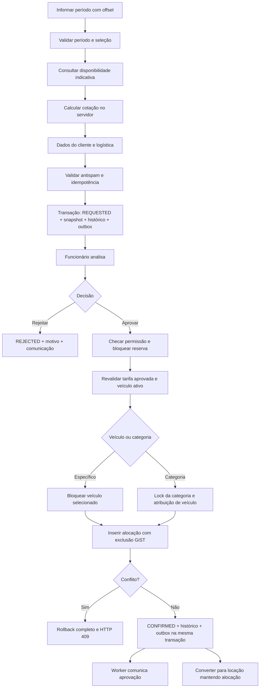
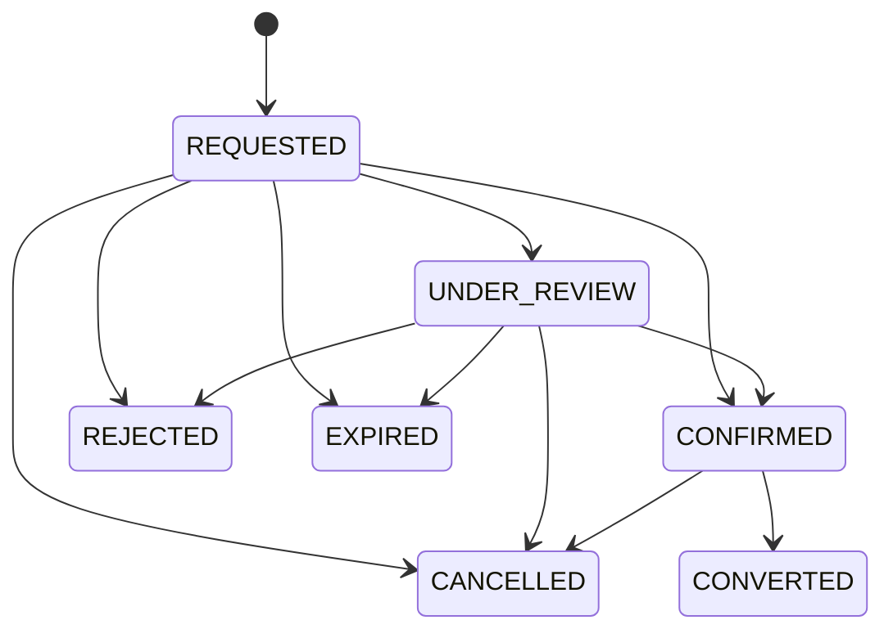

# Reservas

Implementação administrativa da Fase 5 em [reservations.md](../reservations.md). Submissão pública/antispam é Fase 6; conversão em locação é Fase 7; envio da outbox é Fase 8. O fluxo abaixo inclui essas etapas futuras.

## Fluxo

## Máquina de estados

Transições fora do grafo são recusadas; terminais não são reabertos por PATCH. Confirmação/rejeição exigem `reservations.approve`. Cancelamento confirmado exige permissão específica e motivo. Expiração usa RPC restrita e pode ser disparada pelo painel; seu agendamento no ambiente ainda precisa ser configurado. Reserva confirmada não expira automaticamente.

## Invariantes

1. Solicitação pendente não cria ocupação confirmada. Orçamento não garante disponibilidade futura.
2. Seleção tem exatamente um alvo: categoria ou veículo. Um item reservável no MVP; `reservation_items` permite evolução sem duplicar a fonte de alocação.
3. Aprovação é uma RPC transacional: bloquear reserva, validar versão/status, carregar permissões atuais, atribuir veículo, inserir alocação, gravar snapshot/histórico/outbox e concluir.
4. Categoria: serializar decisões por categoria (advisory transaction lock ou lock de linha), selecionar candidato ativo com lock; exclusão GiST continua sendo a defesa final contra todos os outros tipos de alocação.
5. Idempotência devolve o resultado anterior para a mesma chave e payload; chave reutilizada com payload diferente gera 409.
6. Cancelamento libera a alocação na mesma transação do status. Conversão transfere a propriedade da mesma alocação para a locação sem janela de liberação.
7. Alterações de datas/preço exigem recotação/versionamento e nova validação; não aceitar preço final enviado pelo cliente.
8. Status público exige token opaco, expiração e comparação segura; retorna apenas situação, referência pública e orientação mínima.

## Testes de aceite (Fase 5)

- Duas conexões aprovando o mesmo veículo/período: exatamente uma confirmação e uma falha controlada, sem órfãos.
- Categoria com N veículos: N aprovações simultâneas passam e a N+1 falha; sem dupla atribuição.
- Aprovação concorrente com manutenção/bloqueio; um vencedor consistente.
- Repetição de aprovação, cancelamento e conversão com mesma chave; histórico/outbox únicos.
- Limites de intervalo: igualdade, adjacência, timezone, fim menor que início.
- Solicitação expirada, usuário revogado, ausência de permissão e cancelamento após conversão.
