# ER completo proposto

Modelo lógico implementado nas migrations para uma empresa, ainda pendente de aplicação na stack Supabase. Todas as entidades da aplicação possuem UUID PK e timestamps conforme `schema.md`. Campos abaixo destacam chaves e dados centrais; os SQLs em `supabase/migrations` detalham o schema físico. `auth_users` representa `auth.users` gerenciado pelo Supabase. `audit_logs.entity_id`, `notifications.resource_id` e payloads de outbox são referências de rastreabilidade, não FKs polimórficas de integridade operacional.

```mermaid
erDiagram
  auth_users ||--|| profiles : identifica
  profiles ||--o{ user_roles : recebe
  roles ||--o{ user_roles : concede
  roles ||--o{ role_permissions : contem
  permissions ||--o{ role_permissions : define
  branches ||--o{ vehicles : abriga
  branches ||--o{ reservations : recebe
  branches ||--o{ rentals : opera
  branches ||--o{ rental_locations : referencia
  vehicle_categories ||--o{ vehicles : classifica
  vehicles ||--o{ vehicle_images : ilustra
  vehicles ||--o{ vehicle_documents : documenta
  vehicles ||--o{ vehicle_blocks : bloqueia
  vehicles ||--o{ vehicle_allocations : ocupa
  vehicles ||--o{ maintenance_records : recebe
  vehicle_blocks |o--o| vehicle_allocations : origina
  maintenance_records |o--o| vehicle_allocations : origina
  customers ||--o{ drivers : vincula
  customers ||--o{ customer_documents : possui
  customers ||--o{ customer_notes : recebe
  customers |o--o{ quotes : solicita
  customers ||--o{ reservations : solicita
  customers ||--o{ rentals : contrata
  rate_plans ||--o{ rate_plan_prices : precifica
  rate_plans ||--o{ pricing_rules : configura
  rate_plans ||--o{ quotes : calcula
  vehicle_categories |o--o{ rate_plan_prices : tarifa_categoria
  vehicles |o--o{ rate_plan_prices : tarifa_veiculo
  quotes ||--|{ quote_items : detalha
  additional_services |o--o{ quote_items : adicional
  quotes ||--o| reservations : fundamenta
  reservations ||--|{ reservation_items : solicita
  vehicle_categories |o--o{ reservation_items : alvo_categoria
  vehicles |o--o{ reservation_items : alvo_veiculo
  reservations ||--|{ reservation_status_history : registra
  reservations |o--o| vehicle_allocations : origina
  reservations |o--o| rentals : converte
  rentals ||--o{ rental_drivers : autoriza
  drivers ||--o{ rental_drivers : dirige
  vehicles ||--o{ rentals : utiliza
  quotes ||--o{ rentals : valores_aprovados
  rentals |o--o| vehicle_allocations : origina
  rentals ||--o{ rental_extensions : prorroga
  quotes ||--o{ rental_extensions : recotacao
  rentals ||--|{ rental_locations : agenda
  reservations |o--o{ reservation_locations : agenda
  branches |o--o{ reservation_locations : referencia
  contract_templates ||--o{ contracts : versiona
  rentals ||--o{ contracts : formaliza
  inspection_templates ||--o{ inspections : configura
  rentals ||--o{ inspections : evidencia
  profiles ||--o{ inspections : realiza
  inspections ||--|{ inspection_items : detalha
  inspections ||--o{ inspection_photos : comprova
  inspection_items |o--o{ inspection_photos : ilustra
  inspections ||--o{ damages : detecta
  vehicles ||--o{ damages : apresenta
  customers ||--o{ charges : deve
  rentals |o--o{ charges : gera
  damages |o--o{ charges : origina
  customers ||--o{ payments : paga
  payment_methods ||--o{ payments : utiliza
  payments ||--o{ payment_allocations : distribui
  charges ||--o{ payment_allocations : liquida
  rentals ||--o{ deposits : cauciona
  payment_methods ||--o{ deposits : recebe
  payments |o--o{ refunds : compensa
  deposits |o--o{ refunds : devolve
  charges |o--o{ deposits : aplica
  vehicles |o--o{ expenses : atribui
  maintenance_records |o--o{ expenses : custa
  notification_templates |o--o{ notifications : formata
  profiles |o--o{ notifications : recebe
  outbox_events |o--o{ notifications : entrega
  profiles |o--o{ audit_logs : executa
  profiles |o--o{ idempotency_keys : escopo

  auth_users {
    uuid id PK
  }
  profiles {
    uuid id PK,FK
    text display_name
    boolean active
  }
  roles {
    uuid id PK
    text code UK
  }
  user_roles {
    uuid id PK
    uuid user_id FK
    uuid role_id FK
  }
  permissions {
    uuid id PK
    text code UK
  }
  role_permissions {
    uuid id PK
    uuid role_id FK
    uuid permission_id FK
  }
  branches {
    uuid id PK
    text name
    jsonb address
    boolean active
  }
  company_settings {
    uuid id PK
    boolean singleton UK
    text legal_name
    text timezone
    text currency
  }
  system_settings {
    uuid id PK
    text key UK
    jsonb value
    integer version
  }
  vehicle_categories {
    uuid id PK
    text name
    text description
    integer capacity
    jsonb features
    boolean active
  }
  vehicles {
    uuid id PK
    uuid category_id FK
    uuid branch_id FK
    text plate UK
    text chassis UK
    text renavam
    text make
    text model
    text version
    integer manufacture_year
    integer model_year
    text color
    text fuel
    text transmission
    integer passengers
    integer doors
    bigint mileage
    text operational_status
    date acquired_on
    timestamptz archived_at
  }
  vehicle_images {
    uuid id PK
    uuid vehicle_id FK
    text storage_path
    integer sort_order
    text alt_text
  }
  vehicle_documents {
    uuid id PK
    uuid vehicle_id FK
    text storage_path
    text document_type
  }
  vehicle_blocks {
    uuid id PK
    uuid vehicle_id FK
    text reason
    uuid created_by FK
  }
  vehicle_allocations {
    uuid id PK
    uuid vehicle_id FK
    tstzrange period
    text kind
    uuid reservation_id FK
    uuid rental_id FK
    uuid vehicle_block_id FK
    uuid maintenance_record_id FK
    timestamptz released_at
  }
  customers {
    uuid id PK
    text person_type
    text name
    text tax_document UK
    text email
    text phone
    jsonb address
    date birth_date
    timestamptz archived_at
  }
  drivers {
    uuid id PK
    uuid customer_id FK
    text name
    text cpf UK
    text license_number UK
    text license_category
    date license_expires_on
    text document_path
  }
  customer_documents {
    uuid id PK
    uuid customer_id FK
    text storage_path
    text document_type
  }
  customer_notes {
    uuid id PK
    uuid customer_id FK
    uuid author_id FK
    text note
  }
  rate_plans {
    uuid id PK
    text name
    text period_unit
    text month_mode
    jsonb policy
    integer version
    boolean active
  }
  rate_plan_prices {
    uuid id PK
    uuid rate_plan_id FK
    uuid category_id FK
    uuid vehicle_id FK
    tstzrange validity
    numeric amount
  }
  pricing_rules {
    uuid id PK
    uuid rate_plan_id FK
    text rule_type
    integer priority
    integer version
    jsonb parameters
  }
  additional_services {
    uuid id PK
    text name
    text unit
    numeric amount
    boolean active
  }
  quotes {
    uuid id PK
    uuid customer_id FK
    uuid rate_plan_id FK
    timestamptz start_at
    timestamptz end_at
    timestamptz expires_at
    numeric total
    numeric deposit
    text currency
    jsonb rules_snapshot
  }
  quote_items {
    uuid id PK
    uuid quote_id FK
    uuid additional_service_id FK
    text kind
    numeric quantity
    numeric unit_amount
    numeric total
    jsonb snapshot
  }
  reservations {
    uuid id PK
    uuid customer_id FK
    uuid branch_id FK
    uuid quote_id FK,UK
    text status
    timestamptz start_at
    timestamptz end_at
    timestamptz expires_at
    text lookup_token_hash
    timestamptz lookup_expires_at
    integer version
  }
  reservation_items {
    uuid id PK
    uuid reservation_id FK
    uuid category_id FK
    uuid vehicle_id FK
  }
  reservation_status_history {
    uuid id PK
    uuid reservation_id FK
    text from_status
    text to_status
    uuid actor_id FK
    text reason
  }
  reservation_locations {
    uuid id PK
    uuid reservation_id FK
    uuid branch_id FK
    text direction
    text mode
    jsonb address_snapshot
    numeric fee
    timestamptz scheduled_at
  }
  rentals {
    uuid id PK
    uuid reservation_id FK,UK
    uuid customer_id FK
    uuid vehicle_id FK
    uuid branch_id FK
    uuid quote_id FK
    uuid responsible_id FK
    text status
    timestamptz start_at
    timestamptz end_at
    timestamptz actual_start_at
    timestamptz actual_end_at
    bigint initial_mileage
    bigint final_mileage
    numeric initial_fuel
    numeric final_fuel
    jsonb commercial_snapshot
  }
  rental_drivers {
    uuid id PK
    uuid rental_id FK
    uuid driver_id FK
    jsonb driver_snapshot
  }
  rental_extensions {
    uuid id PK
    uuid rental_id FK
    uuid quote_id FK
    timestamptz previous_end_at
    timestamptz new_end_at
    uuid approved_by FK
  }
  rental_locations {
    uuid id PK
    uuid rental_id FK
    uuid branch_id FK
    text direction
    text mode
    jsonb address_snapshot
    numeric fee
    text instructions
    uuid responsible_id FK
    timestamptz scheduled_at
    timestamptz performed_at
  }
  contract_templates {
    uuid id PK
    text template_key
    integer version
    text body
    text review_status
  }
  contracts {
    uuid id PK
    uuid rental_id FK
    uuid template_id FK
    integer version
    text storage_path
    text sha256
    jsonb snapshot
    text generation_status
  }
  inspection_templates {
    uuid id PK
    text name
    integer version
    jsonb checklist
    boolean active
  }
  inspections {
    uuid id PK
    uuid rental_id FK
    uuid template_id FK
    uuid inspector_id FK
    text kind
    bigint mileage
    numeric fuel
    jsonb checklist_snapshot
    timestamptz completed_at
  }
  inspection_items {
    uuid id PK
    uuid inspection_id FK
    text item_key
    text condition
    text notes
  }
  inspection_photos {
    uuid id PK
    uuid inspection_id FK
    uuid item_id FK
    text storage_path
    text sha256
  }
  damages {
    uuid id PK
    uuid vehicle_id FK
    uuid inspection_id FK
    text description
    text status
  }
  charges {
    uuid id PK
    uuid customer_id FK
    uuid rental_id FK
    uuid damage_id FK
    text kind
    numeric amount
    timestamptz due_at
  }
  payment_methods {
    uuid id PK
    text name
    boolean active
  }
  payments {
    uuid id PK
    uuid customer_id FK
    uuid payment_method_id FK
    numeric amount
    text status
    uuid confirmed_by FK
    timestamptz confirmed_at
    text idempotency_key UK
  }
  payment_allocations {
    uuid id PK
    uuid payment_id FK
    uuid charge_id FK
    numeric amount
  }
  deposits {
    uuid id PK
    uuid rental_id FK
    uuid payment_method_id FK
    uuid applied_charge_id FK
    numeric amount
    text kind
    uuid original_deposit_id FK
    uuid confirmed_by FK
  }
  refunds {
    uuid id PK
    uuid payment_id FK
    uuid payment_allocation_id FK
    uuid deposit_id FK
    numeric amount
    text reason
    uuid confirmed_by FK
  }
  expenses {
    uuid id PK
    uuid vehicle_id FK
    uuid maintenance_record_id FK
    numeric amount
    timestamptz occurred_at
    text description
  }
  maintenance_records {
    uuid id PK
    uuid vehicle_id FK
    text kind
    text status
    bigint mileage
    date next_due_on
    bigint next_due_mileage
    boolean blocks_availability
  }
  notifications {
    uuid id PK
    uuid template_id FK
    uuid outbox_event_id FK
    uuid recipient_profile_id FK
    uuid resource_id
    text channel
    text status
    integer attempts
  }
  notification_templates {
    uuid id PK
    text template_key
    integer version
    text channel
    text body
  }
  outbox_events {
    uuid id PK
    text event_type
    jsonb payload
    text status
    integer attempts
    timestamptz available_at
    timestamptz locked_until
    text deduplication_key UK
  }
  audit_logs {
    uuid id PK
    uuid actor_id FK
    text action
    text entity_type
    uuid entity_id
    uuid correlation_id
    jsonb safe_changes
  }
  idempotency_keys {
    uuid id PK
    uuid actor_id FK
    text operation
    text key
    text request_hash
    jsonb safe_response
    timestamptz expires_at
  }
  rate_limit_buckets {
    uuid id PK
    text scope_key_hash UK
    timestamptz window_start
    integer count
    timestamptz expires_at
  }
```

Auxiliares além da lista inicial: `reservation_locations` preserva logística antes de existir locação; `inspection_templates` permite checklist versionado; `payment_methods` evita meios fixos no código; `idempotency_keys` e `rate_limit_buckets` suportam segurança distribuída. Autorreferência de cauções e FKs de autoria apontam para as entidades correspondentes, sem duplicar arestas para manter leitura do diagrama.
